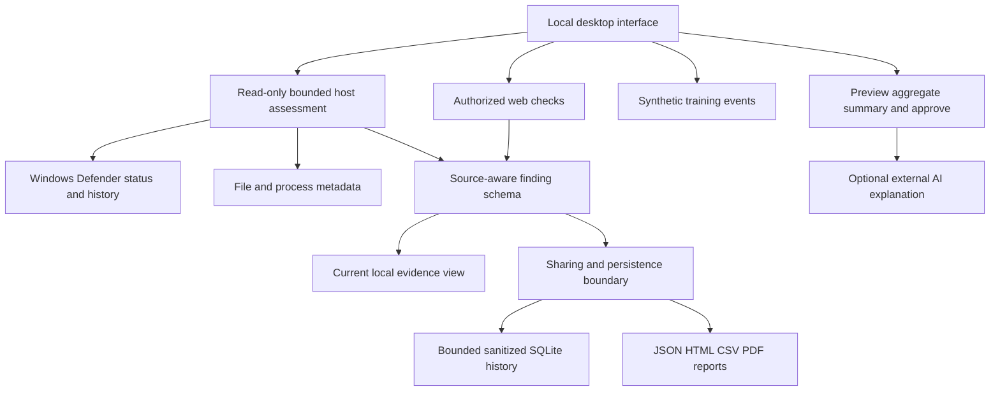

# CORTEX graduation project: scope, architecture and validation

## Purpose and defensible claims

CORTEX is a local evidence collection and security review platform with an authorized web-assessment component and a separate synthetic training area. It is not a replacement antivirus engine, a compliance certification tool, or proof that a device is safe. Host observations, engine-reported detections and web rule findings must retain their different meanings.

The primary workflow is: choose host review or an authorized web audit, review its scope, run or cancel, inspect findings and coverage, compare saved assessments, then export a sanitized report. Advanced modules remain in their existing tabs to preserve compatibility. Training actions never contribute to audited risk.

## Architecture



`core/findings.py` provides stable record identifiers, source, classification, severity, confidence basis, timestamps, recommended actions and limitations. Legacy web detector scores are labelled as uncalibrated detector scores rather than infection probabilities. A general vulnerability type does not establish a product/version-specific CVE; the old guessed CVE enrichment is disabled. Reports use the same shared generator rather than divergent duplicate templates.

## Coverage and lifecycle

- Host review reads Defender status/history, running process metadata and bounded file samples. Existing limits remain 15 candidate files per listed directory, a 90-second content inspection budget and a 256 MiB per-file hashing limit. Signature queries have their own timeout.
- The desktop host deadline is 180 seconds and the desktop web deadline is 300 seconds. Cancellation is cooperative: in-flight Windows queries can finish before control returns. No thread is forcibly killed and no host data is modified.
- Cancelled or timed-out host results remain partial. A failed or interrupted web assessment is not counted as a successful empty result. The desktop prevents conflicting host, evidence and web tasks; controls are restored after failure.
- Web crawling is restricted to the configured origin (scheme, host and port); response redirects are not silently followed by the primary fetcher. Dynamic browser resources outside that origin are blocked. Third-party integrations/plugins still require independent review; CORTEX is not a network sandbox.
- Crawl depth is enforced; the local API accepts depth 0-10, concurrency 1-50, at most two active jobs and retains at most 100 in-memory job records. `POST /cancel/<id>` requests cancellation. The API binds to loopback by default and is not an authenticated public hosting service. Startup no longer deletes previous reports.
- Missing permissions, unavailable providers, file changes and skipped work are unknown rather than safe. A low index is not a clearance certificate.

## Privacy and training boundary

The current local evidence view can include private paths and process arguments needed for investigation. Shared outputs and saved history omit command lines, raw response evidence and secret-labelled fields; they also redact common secret strings, URL user information/query values and Windows user-directory names. Source objects are copied rather than destructively altered. This conservative filter reduces accidental disclosure but is not a complete data-loss-prevention engine: review exports before sharing. Previously generated files/databases are not rewritten or erased by this update.

Automatic AI response-body inspection and automatic AI patch generation are disabled in the web scan. The desktop AI action shows the exact aggregate payload before an external call. It includes counts and selected coverage flags, not local files, raw HTTP bodies, Wi-Fi credentials or process arguments. The configured provider must be available; no key means an explicit unavailable explanation. AI cannot alter stored classifications or independently establish compromise/compliance.

`simulation/leak.py`, `simulation/persist.py` and `simulation/ransom.py` are synthetic exercises. They do not enumerate credentials, scan user documents, encrypt files, write startup files or edit registry keys. The old `exfiltrate_wifi_passwords` entry point is retained as a safe compatibility message, not a secret collector. This intentionally changes the earlier credential-printing command. A real credential-reveal interface is outside this release; it must not be reintroduced through a training button.

## Local history and comparison

`core/history.py` stores sanitized snapshots under the current user's `.cortex/scan_history.db`, retaining at most 100 assessments. The UI provides review, comparison of two matching scopes, and explicit clearing. Stable IDs exclude volatile timestamps/PIDs; the comparison shows new, persistent, changed and not-observed items. An item disappearing from a bounded or interrupted scan is **not** labelled fixed or remediated. Both coverage records and run statuses remain visible. A digest of the original scope prevents different targets with identical redacted labels from being compared. History is local and is not encrypted by CORTEX; operating-system account/file protections still apply.

## Reproducible evaluation

From the repository root:

```powershell
python -m unittest discover -s tests -p "test_*.py" -v
python -m evaluation.run --output output/evaluation/policy.json
python qa_test.py
python test_fixed.py
```

`evaluation/policy_cases.json` contains 12 fictional, manually labelled process-policy cases, including ordinary AppData executables, unsigned/dual-use tools, isolated weak indicators, correlated review indicators and unknown inspection state. No executable payloads or live malware are included. The evaluator records dataset SHA-256, confusion counts, precision, recall, false-positive rate, unknown/decision coverage and elapsed time. Unknown positive cases count as missed review rather than being dropped from the denominator. Here a positive means **requires review under the fixture policy**, not confirmed malware.

For these particular fixtures the intended outcome is 2 true positives, 1 missed review due to unavailable evidence, 9 negatives without a false review, and 2 unknowns overall. The positive-case recall is therefore 2/3, demonstrating why a passing policy test must not be marketed as 100% detection. These numbers measure only the supplied fixtures, not real-world detection effectiveness. Timing is environment-dependent.

## Independent evaluation protocol and graduation deliverables

An independent specialist should label a separate lawful benign/malicious corpus, record its provenance and consent, split development and held-out cases, and run it in a disposable isolated lab. Record false positives/negatives, unknown and coverage rates, runtime, versions and repeatability. Report outcomes against actual malware ground truth separately from policy-review labels; do not execute malware in normal CI or on a personal laptop. Native Defender quarantine/restore requires a separate authorized disposable test.

The submission should include: the project objective and threat model; architecture and data flow; reproducible setup and test commands; a dated evaluation report with dataset hash and limitations; examples of sanitized host/web reports and history comparisons; and a clear list of out-of-scope claims. The automated tests and GitHub Windows Python 3.11/3.12 jobs validate implemented behavior; an independent effectiveness assessment is still an external deliverable.
